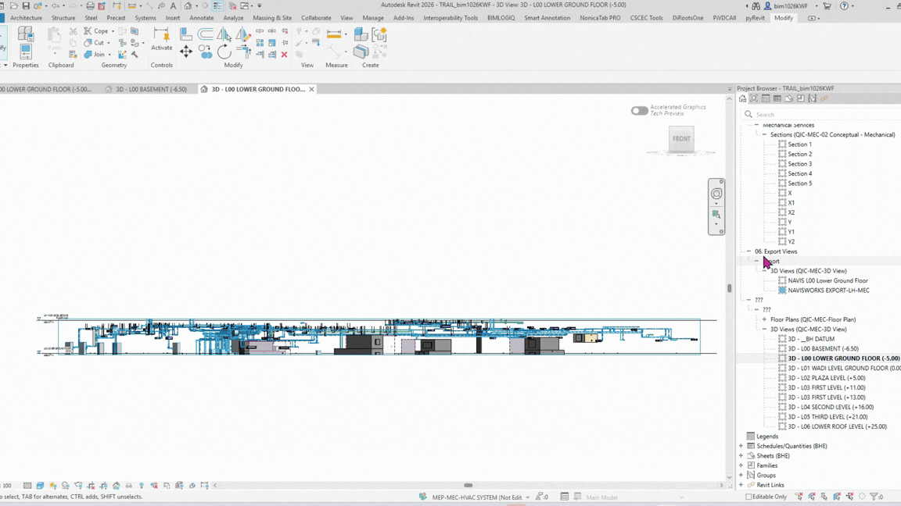

# 3D View Segregation by Level (Linked ARC Model)

**Sample run:** scans a linked architectural model, works out its true extents, and automatically creates one isometric 3D view per level — each one section-boxed to just that floor — skipping any that already exist.

## Overview
This script automates a setup task every coordination project needs but nobody enjoys doing by hand: a clean, section-boxed 3D view for every level in the building, scoped tightly to the linked ARC model's real footprint rather than an arbitrary default. Instead of manually drawing a section box per floor and eyeballing the extents, the script measures the actual linked model geometry once, then stamps out one view per level automatically — skipping levels that already have a view so it's safe to re-run as the model grows.

## Problem it solves
On a large multi-level project, modelers often work across MEP, structure, and architecture using separate 3D views per floor to keep clash detection, screenshots, and review sessions manageable. Setting these up manually — one section box per level, each one manually resized to match the building footprint — takes time and is easy to get inconsistent across levels. This script builds the whole set in one run, consistently scoped to the real model extents (plus a small buffer), and reports exactly what was created, skipped, or failed.

## How it works
1. **Select the linked ARC model**: the user wires in a `RevitLinkInstance` (the architecture link).
2. **Resolve link geometry**: the script opens the link document and reads its transform, converting the architecture link's own coordinates into host-model coordinates.
3. **Filter categories**: excludes non-physical/annotation categories (grids, levels, reference planes, cameras, elevation/section markers, views, topography, site, base points, sun path, scope boxes) so only real model geometry contributes to the bounding box.
4. **Measure true extents**: iterates every remaining model-category element in the link, collects each one's bounding box, transforms it into host coordinates, and tracks the running min/max X and Y — effectively computing the building's real footprint. A small XY buffer (500 mm) is added around the result.
5. **Get host levels**: collects and sorts all levels in the *host* document by elevation.
6. **Create one 3D view per level**: for each level, creates an isometric 3D view named `3D - <Level Name>`, builds a section box using the measured XY footprint and a Z range from the current level (minus a bottom offset) up to the next level (plus a top offset), and assigns it to the view. Already-existing view names are skipped rather than duplicated.
7. **Diagnostics**: if no valid geometry is found (e.g. empty/unloaded link, everything filtered out), the script returns a detailed diagnostic report instead — counts of elements scanned, skipped by category/type, bounding-box or transform failures, and the top categories actually seen — making a bad run easy to troubleshoot instead of a silent failure.

## Inputs
| Input | Type | Description |
|-------|------|--------------|
| `IN[0]` | Revit Link Instance | The linked architecture (ARC) model to measure and build views from |
| `IN[1]` | number (mm) | Bottom offset below each level's elevation for the section box |
| `IN[2]` | number (mm) | Top offset above the next level's elevation for the section box |

## Output
On success: `Created Views`, `Skipped Views` (with reason, e.g. "Already exists"), `Errors` (per level, if any), plus the measured `Building X/Y Min/Max` extents and the offsets used.

On failure to find geometry: a full diagnostic breakdown (elements scanned, excluded by category, no bounding box, transform failures, with samples) plus the top 15 categories actually encountered in the link.

## Tools / environment
- Revit 2026
- Dynamo 3.4.1 (CPython3 engine)
- Revit API: `RevitAPI`, `RevitServices`

## Assumptions
- `IN[0]` is a loaded (not unloaded) `RevitLinkInstance` — the script raises a clear error if the link can't be unwrapped or is unloaded.
- The host document already has a standard isometric 3D `ViewFamilyType` available.
- View names follow the `3D - <Level Name>` convention; a project with levels already using that naming pattern will have those views skipped automatically on re-run.

## Before / After
